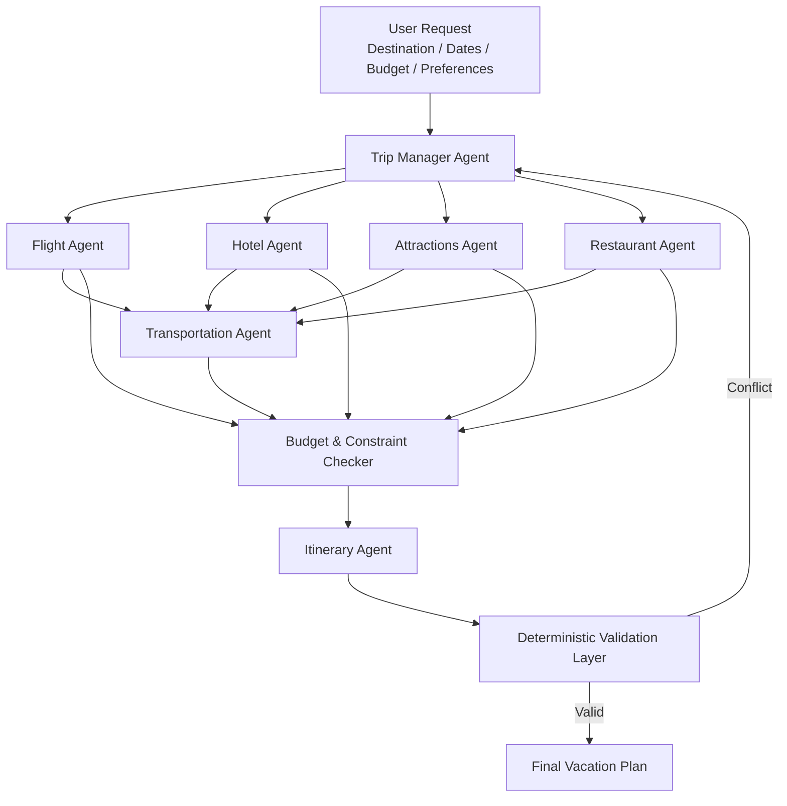

# Travel Agent — Project Charter

**Multi-Agent AI System for Personalized Vacation Planning**

> **Note:** The project scope, data sources, architecture, and targets may be adjusted according to API availability, evaluation results, and project milestones.

---

## 1. Problem & Target User

**Target User:**  
An independent traveler planning a **3–5 day city vacation** with a defined destination, travel dates, number of travelers, approximate budget, and personal preferences.

**Problem:**  
Vacation planning is fragmented across multiple services. A traveler must separately search for flights, accommodation, attractions, restaurants, and local transportation, then combine all results into a realistic day-by-day schedule while keeping the total trip within budget.

The planning process requires repeated trade-offs between price, location, travel time, personal interests, and daily intensity. A low-cost hotel may increase transportation time; a highly rated attraction may not fit the schedule; and a recommended restaurant may be too far from the planned activity.

**Travel Agent** will coordinate these decisions through a multi-agent workflow and generate a complete, personalized vacation plan.

For the benchmark scenario, the goal is to produce an initial **3–5 day itinerary in under five minutes**, while satisfying the traveler’s major constraints.

The system is a **decision-support and planning tool only**. It will recommend options but will not purchase flights, reserve hotels, book restaurants, or execute financial transactions.

---

## 2. Success Metrics & Evaluation

| Component | Target & Evaluation |
|---|---|
| **Hard Constraint Compliance** | At least **95%** of generated itineraries respect travel dates, number of travelers, and maximum budget |
| **Schedule Feasibility** | At least **90%** of consecutive itinerary items have feasible travel time between them |
| **Preference Coverage** | At least **80%** of explicitly requested user preferences appear in the final itinerary |
| **Agent / Tool Selection** | At least **85%** correct routing to the relevant agent/tool across a manually labeled evaluation set |
| **Groundedness** | At least **90%** of factual recommendations such as price, location, rating, or opening information are supported by retrieved data |
| **Planning Latency** | Generate an initial 3–5 day trip plan in **under five minutes** |

### Baseline

The multi-agent solution will be compared with a simpler deterministic baseline:

**User constraints → retrieve top-N options → rank by predefined rating/cost rules → allocate activities sequentially by day.**

The baseline will not dynamically reconsider options when conflicts arise between budget, travel time, schedule, or user preferences.

The multi-agent version is expected to improve **constraint satisfaction, itinerary feasibility, and preference coverage** compared with the baseline.

---

## 3. Data Sources & Plan B

### Primary Data Sources

The system will combine several structured external data sources.

**Flights & Hotels**
- Travel-search API such as **Amadeus** or an equivalent provider.
- Used for candidate flights, hotels, dates, prices, and availability.

**Attractions & Restaurants**
- **OpenStreetMap / Overpass API** and potentially **Wikidata** or another public POI source.
- Used for locations, categories, coordinates, and available metadata.

**Transportation**
- Routing API such as **OpenRouteService / OSRM**.
- Public transportation data such as **GTFS** may be added for supported destinations.
- Used to estimate distance, travel time, and transportation mode between hotels, attractions, and restaurants.

### Evaluation Dataset

We will build a manually defined evaluation set of approximately **40–50 vacation requests**, varying:

- destination;
- trip duration;
- budget;
- number of travelers;
- interests;
- restaurant preferences;
- preferred daily activity level;
- transportation preferences.

Each scenario will include explicit hard and soft constraints that can be checked automatically or manually.

### Reproducibility

Because prices and availability change over time, retrieved API responses will also be stored as **timestamped local JSON/CSV snapshots** for evaluation and reproducibility.

### Plan B

If one or more live travel APIs cannot be reliably accessed, the project will use **pre-collected static flight and hotel data for several selected European destinations**, while keeping the same agentic workflow.

If the routing service fails, transportation time will fall back to deterministic distance calculations and predefined travel-speed assumptions.

---

## 4. System Architecture

### Main Components

- **Trip Manager Agent** — interprets the user request, separates hard constraints from soft preferences, delegates tasks, and coordinates revisions.
- **Flight Agent** — searches and compares relevant flight alternatives.
- **Hotel Agent** — identifies accommodation options according to price, location, and preferences.
- **Attractions Agent** — selects activities and attractions matching the traveler’s interests.
- **Restaurant Agent** — identifies dining options according to preferences, location, and schedule.
- **Transportation Agent** — calculates travel time and evaluates suitable transportation between itinerary locations.
- **Itinerary Agent** — combines the selected options into a day-by-day plan.
- **Budget & Constraint Checker** — deterministic code that validates budget, time conflicts, duplicate activities, and other hard constraints.

---

## 5. The Agent's Seat

### What does the agentic layer decide that standard code cannot?

Deterministic code is appropriate for arithmetic, budget checks, time comparisons, and distance calculations. The agentic layer is responsible for **interpretation, trade-offs, delegation, and replanning**.

Example user request:

> “I prefer food and history, I do not want very busy days, I would rather stay near the city center even if the hotel costs slightly more, and I want one evening free.”

These preferences cannot be represented reliably by a single fixed ranking formula.

The **Trip Manager Agent** decides:

1. which user requirements are hard constraints and which are soft preferences;
2. which specialized agents should be used;
3. how to balance trade-offs between cost, location, travel time, and interests;
4. when an existing recommendation should be rejected and a new alternative requested.

For example, a cheaper hotel may be rejected if it causes excessive transportation time throughout the trip.

### Agent Tools

- `search_flights()` — retrieves flight candidates.
- `search_hotels()` — retrieves accommodation candidates.
- `search_places()` — retrieves attractions and restaurants.
- `calculate_route()` — returns distance and estimated travel time.
- `calculate_trip_cost()` — performs deterministic total-cost calculation.
- `check_schedule_conflicts()` — checks overlaps and travel-time feasibility.
- `validate_budget()` — checks the proposed trip against the user’s maximum budget.

### Guardrails & Failure Handling

The agents will **not invent prices, schedules, ratings, opening hours, or availability** when these values are missing.

Every retrieved factual result will retain its source and retrieval timestamp.

The system will limit agent revision loops to control latency and LLM/API cost.

If an agent or external API fails, the system will:

1. retry a limited number of times;
2. use cached data when available;
3. clearly mark unavailable information;
4. continue with a deterministic baseline when possible.

**The core pipeline will therefore remain functional even without the multi-agent layer.**

Without the agents, the system will retrieve candidate locations, rank them using predefined rules, and produce a basic itinerary.

---

## 6. Risks & Scope Cut

| Risk | Mitigation |
|---|---|
| **Travel APIs may have access, quota, or pricing limitations** | Cache responses and maintain static datasets for selected destinations |
| **Prices, availability, and opening hours change frequently** | Store retrieval timestamps, avoid presenting values as guaranteed, and require verification before booking |
| **Multiple interacting agents may create excessive complexity, latency, or LLM cost** | Parallelize independent tasks, limit retries, and use deterministic code whenever reasoning is not required |

### Scope Cut

If major components are not stable two weeks before final submission, the system will be restricted to:

- **one or two selected European destinations**;
- a **three-day itinerary**;
- cached flight and hotel data instead of live APIs.

The simplified version will retain a genuine multi-agent workflow:

**Trip Manager → Places Agent → Transportation Agent → Itinerary Agent → Deterministic Budget/Constraint Checker**

Restaurants and attractions will be merged into a single **Places Agent**, while flights and hotels may be treated as structured inputs.

This version will still demonstrate agent collaboration, transportation planning, constraint checking, and end-to-end itinerary generation.

---

## 7. Milestones & Team Roles

| Date | Deliverable | Main Responsibility |
|---|---|---|
| **18.10.26 — Checkpoint 1** | End-to-end baseline: user input → data retrieval → simple itinerary | Data Lead + Model/Evaluation Lead |
| **30.10.26 — Checkpoint 2** | Multi-agent workflow integrated; Transportation Agent and guardrails operational | Agent Lead |
| **01.11.26** | Repository freeze before mentoring session | Entire Team |
| **04.11.26** | Working system + initial evaluation + draft presentation | Product Lead |
| **12.11.26** | Final system, evaluation, README, and presentation | Entire Team |

### Team Hats

**Product Lead — [Name]**  
User requirements, UX, business value, documentation, and presentation.

**Agent Lead — [Name]**  
Multi-agent architecture, prompts, tools, orchestration, and guardrails.

**Data Lead — [Name]**  
APIs, data collection, caching, validation, and data dictionary.

**Model / Evaluation Lead — [Name]**  
Baseline, evaluation set, metrics, experiments, and error analysis.

All team members will contribute code and review major project decisions.
