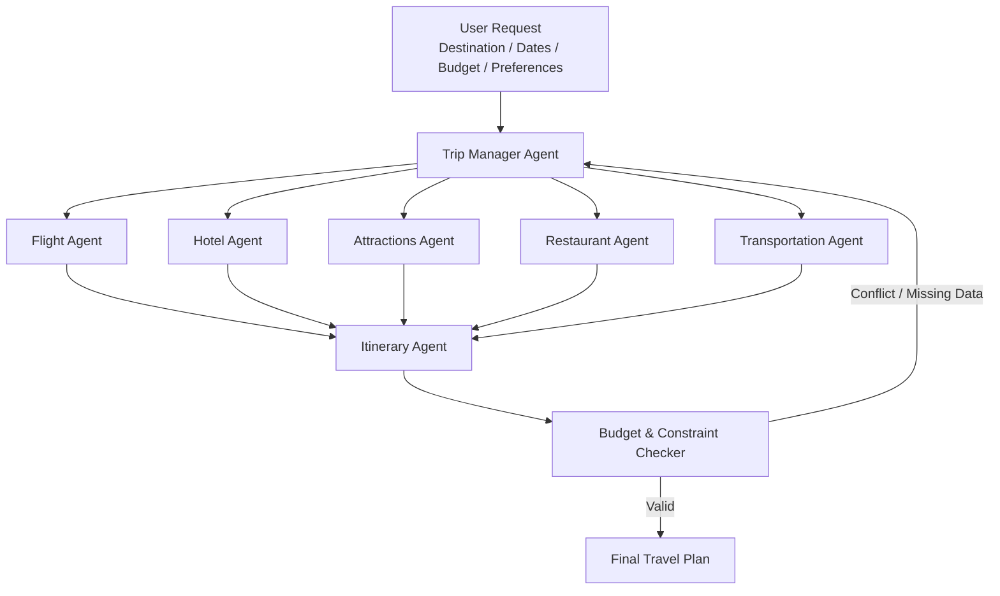

# Travel Agent — Project Charter

**Multi-Agent AI System for Personalized Vacation Planning**

> The project may change slightly during development, depending on API availability, data quality, and the results of the checkpoints.

---

## 1. Problem and Target User

**Target user:**  
A traveler planning a short city vacation of about **3–5 days**, with known dates, number of travelers, budget, and personal preferences.

Planning a vacation usually requires using several different websites or apps: flights, hotels, attractions, restaurants, transportation, and maps. The user then has to connect all of this information manually and make sure the plan is realistic.

The main difficulty is not only finding good options, but combining them. For example, a hotel can be cheap but far from most attractions, or a restaurant can be highly rated but not fit the route of that day.

**Travel Agent** will try to solve this by using several specialized agents that work together and produce one complete trip plan.

The goal is to create an initial **3–5 day travel plan in under five minutes**, while respecting the main user constraints.

The system will only recommend options. It will not make bookings, purchases, or payments.

---

## 2. Success Metrics

| Metric | Target |
|---|---|
| Hard constraint compliance | At least **95%** of plans respect dates, number of travelers, and budget |
| Schedule feasibility | At least **90%** of consecutive activities have realistic travel time between them |
| Preference coverage | At least **80%** of the user’s stated preferences appear in the final plan |
| Agent/tool selection | At least **85%** correct routing in a manually labeled evaluation set |
| Groundedness | At least **90%** of factual details such as price, location, rating, or opening information are based on retrieved data |
| Planning time | Initial plan produced in **under five minutes** |

### Baseline

We will compare the multi-agent system with a simpler non-agentic baseline:

**User input → retrieve top options → rank by fixed rules → place them into the itinerary.**

The baseline will not perform dynamic replanning when conflicts appear between budget, location, travel time, or preferences.

---

## 3. Data and Plan B

### Main Data Sources

**Flights and Hotels**
- Travel API such as **Amadeus**, or a similar provider.
- Used for dates, prices, hotels, and flight alternatives.

**Attractions and Restaurants**
- **OpenStreetMap / Overpass API**, with possible use of **Wikidata** or another public POI source.
- Used for places, categories, coordinates, and available metadata.

**Transportation**
- Routing service such as **OpenRouteService / OSRM**.
- If possible, public transportation data such as **GTFS** will also be used.
- Used for travel time, distance, and possible transportation modes.

### Evaluation Data

We will create around **40–50 test travel requests** with different combinations of:

- destination;
- trip duration;
- budget;
- number of travelers;
- interests;
- food preferences;
- preferred activity level;
- transportation preferences.

Each case will include constraints that we can later check against the generated plan.

To make the experiments reproducible, API responses used for evaluation will also be saved locally as timestamped JSON/CSV files.

### Plan B

If live flight or hotel APIs are not reliable enough, we will work with a **pre-collected dataset for a small number of European cities**.

If the routing API is unavailable, we will use geographic distance and simple travel-time assumptions as a fallback.

---

## 4. System Architecture

### Agents

- **Trip Manager Agent** — receives the user request, identifies constraints and preferences, and decides which agents need to run or run again.
- **Flight Agent** — searches and compares flight alternatives.
- **Hotel Agent** — searches accommodation options based on price, location, and preferences.
- **Attractions Agent** — finds activities and attractions that match the traveler’s interests.
- **Restaurant Agent** — finds restaurants that fit the user’s preferences and the daily plan.
- **Transportation Agent** — checks travel time and transportation options between relevant locations.
- **Itinerary Agent** — combines the results into a day-by-day itinerary.

The **Transportation Agent is on the same level as the other specialist agents**. It is not a separate later stage. In practice, the Trip Manager may call it several times while comparing hotels, attractions, and restaurants.

The **Budget & Constraint Checker** will be regular deterministic code, not an LLM agent.

---

## 5. The Agent's Seat

The agents are useful where the system needs to understand preferences and make trade-offs.

For example:

> “I like food and history, I do not want very busy days, I prefer to stay in the center even if the hotel is slightly more expensive, and I want one free evening.”

A fixed formula is not enough to handle this type of request well.

The **Trip Manager Agent** will decide:

- which requirements are hard constraints and which are preferences;
- which specialist agents should be called;
- when two recommendations conflict;
- when an agent should be asked for another option.

Example: if the Hotel Agent finds a cheaper hotel but the Transportation Agent shows that it adds a lot of travel time every day, the Trip Manager may ask for a different hotel.

### Main Tools

- `search_flights()`
- `search_hotels()`
- `search_places()`
- `calculate_route()`
- `calculate_trip_cost()`
- `check_schedule_conflicts()`
- `validate_budget()`

### Failure Handling / Guardrails

The system will not invent prices, opening hours, ratings, or availability when the data is missing.

If an API or agent fails, the system will:

1. retry a limited number of times;
2. use cached data when available;
3. mark missing information clearly;
4. continue with the simpler baseline if possible.

The system must still be able to produce a basic result without the multi-agent layer.

---

## 6. Risks and Scope Cut

| Risk | Mitigation |
|---|---|
| API limitations, quotas, or access problems | Cache results and keep static backup data |
| Prices and availability change over time | Save retrieval timestamps and clearly state that results are not guaranteed |
| Too many agents create unnecessary complexity or cost | Keep only tasks that require reasoning as agents; use regular code for calculations and validations |

### Scope Cut

If the full system is not stable two weeks before submission, we will reduce the scope to:

- **one or two European cities**;
- a **three-day itinerary**;
- cached flight and hotel data instead of live data.

In the reduced version, restaurants and attractions can be combined into one **Places Agent**, while the core flow remains:

**Trip Manager → Specialist Agents → Itinerary Agent → Budget & Constraint Checker**

This will still demonstrate a working multi-agent planning system from input to final itinerary.

---

## 7. Milestones and Team Roles

| Date | Deliverable | Main Responsibility |
|---|---|---|
| **18.10.26 — Checkpoint 1** | Working baseline: user input → data retrieval → simple itinerary | Data + Evaluation |
| **30.10.26 — Checkpoint 2** | Agents integrated, including Transportation Agent and basic guardrails | Agent Lead |
| **01.11.26** | Repository freeze before mentoring | Entire Team |
| **04.11.26** | Working system, first evaluation results, draft presentation | Product Lead |
| **12.11.26** | Final system, evaluation, README, and presentation | Entire Team |

### Team Hats

**Product Lead — [TBD]**  
User requirements, documentation, UX, and presentation.

**Agent Lead — [TBD]**  
Agent architecture, prompts, tools, orchestration, and guardrails.

**Data Lead — [TBD]**  
APIs, data collection, caching, validation, and data dictionary.

**Model / Evaluation Lead — [TBD]**  
Baseline, evaluation set, metrics, experiments, and error analysis.

All team members will contribute code and review major decisions.
