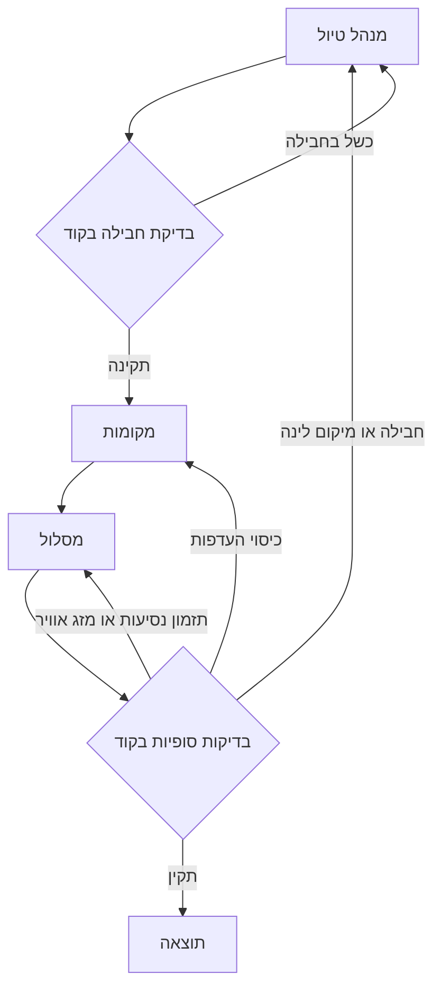

# היקף הפרויקט וחלוקת אחריות

עודכן ב־27.10.2026 לקראת Checkpoint 2 ב־30.10.2026. מסמך זה מקבע את היקף העבודה הנוכחי ואת השיבוץ שביקש רן. השיבוץ נעשה שרירותית וניתן להעביר אחריות בין חברי הצוות בתיאום.

## ההיקף המאושר

הפרויקט משווה תכנון טיול קבוצתי באמצעות A קוד כללים, B סוכן יחיד ו־C שלושה סוכנים: מנהל טיול, מקומות ומסלול. כל המערכות נשענות על אותם נתונים ובדיקות. B ו־C יושוו באותו מודל ובהגדרות משותפות. ההשוואה הראשית המתוכננת נשענת על קלט מובנה; טיפול נוסף בטקסט חופשי אינו תנאי להשלמת משימה 1.

הנתונים המקומיים הקיימים כוללים את שיקגו וניו יורק. עד 30.10 נדרשת הוכחת הרצה מקצה לקצה בעיר אחת במסגרת משימות ההמשך. המערכת ממליצה בלבד. אין הזמנות או תשלומים, ואין לייחס לנתונים היסטוריים ולזמינות מדומה תוקף של מידע חי.

| מערכת | מזהה בהרצה | מימוש |
|---|---|---|
| A | rules | rules_strong.py הוא ברירת המחדל. rules_basic נשמר כגרסת ייחוס נוספת. |
| B | single | סוכן TripPlanner יחיד עם שמונת הכלים המשותפים. |
| C | multi | trip_manager ואז places ואז itinerary בתוך CrewAI Flow. |

לכל מערכת תקציב כולל של עד שלושה סבבי תכנון ו־270 שניות. הסבב הראשון נכלל במגבלה; אין שלושה סבבים לכל סוכן בנפרד. ניסיונות חוזרים של guardrail או ספק אינם סבב תכנון נוסף, אך צורכים זמן וקריאות מודל. לכן שלושה סבבים אינם מבטיחים שלוש קריאות מודל בלבד. המתזמר ב־comparison.py אוכף את זמן התהליך. סף 300 השניות בדיווח המדד אינו הארכה של תקציב הריצה.

## הסוכנים וההצדקה

| מערכת ותפקיד | הצדקה | פלט קיים |
|---|---|---|
| B TripPlanner | מרכז את כל החלטות התכנון כדי לבדוק אם סוכן אחד עם כל הכלים מספיק להפקת תוכנית תקינה. | TripPlan |
| C trip_manager מנהל טיול | בוחר טיסות, לינה ורכב ומנמק פשרות, משום שהחלטות החבילה מחייבות איזון משותף בין מחיר, תאריכים ומיקום. | PackageDecision |
| C places מקומות | בוחר אטרקציות ומסעדות לפי ההעדפות ומיקום הלינה כדי לרכז את התאמת התוכן ואת מקורות המידע. | PlaceShortlist |
| C itinerary מסלול | משבץ מקומות לימים ולשעות לפי נסיעות, קצב ומזג אוויר כדי לרכז את בדיקת האפשרות לבצע את התוכנית. | ItineraryPlan |

הפיצול לשלושה נועד לבדוק אם התמחות ותיקון ממוקד משפרים תכנון לעומת סוכן יחיד. זו השערה להשוואה, ולא יתרון שכבר נמדד. מנהל הטיול הקיים אחראי לחבילה; קוד ה־Flow מנתב תיקונים והוולידטורים קובעים את תוצאת הבדיקות.

## זרימת C וניתוב תיקונים

כשל תקציב, תאריכים, קיבולת או רכב, וכן HOTEL_TOO_FAR, חוזר למנהל הטיול. שינוי בחבילה מאפס את רשימת המקומות ואת המסלול, והם נבנים מחדש. כשל coverage עשוי להחזיר ל־places פעם אחת; לאחר מכן כשל שנותר מופנה למסלול. כשל עומס, נסיעות או מזג אוויר חוזר ל־itinerary. בדיקת מקור או סכמת פלט יכולה לגרום לניסיון חוזר של אותו סוכן. כל החזרות כפופות למגבלות הכוללות.

## חלוקת אחריות

חברי הצוות הם רן, גלית, שמואל ודניאל. כובע הוא אחריות של אדם בצוות ואינו סוכן נוסף במערכת. אדם אחד יכול לשאת בכמה תחומים. בעל האחריות מרכז את העבודה והבודק הנוסף בוחן את התוצר לפני שילובו.

| תחום | אחראי/ת | בודק/ת נוסף/ת | אחריות |
|---|---|---|---|
| מוצר ותיעוד | רן | גלית | היקף, תיעוד, תוצרים למרצה וריכוז המשימות |
| סוכנים ואינטגרציה | גלית | דניאל | B, זרימת C, ממשקים, סבבים ותקציב זמן |
| נתונים וכלים | שמואל | גלית | קטלוג, כלי חיפוש וחישוב, מקורות ואומדנים |
| מודלים והערכה | דניאל | שמואל | A, הגדרות ההשוואה, בדיקות ודוחות |
| C מנהל טיול | גלית | רן | חבילת טיסות ולינה ורכב לפי צורך, תמחור ופשרות |
| C מקומות | שמואל | דניאל | אטרקציות ומסעדות, התאמה להעדפות ומקורות |
| C מסלול | דניאל | גלית | ימים ושעות, נסיעות, עומס ומזג אוויר |

במשימה 1 מעדכנים היקף, תיעוד ושיבוץ. השיבוץ לעיל חל גם על רכיבי ההמשך, אך אינו מציין שכבר בוצעו הרצות או תיקוני קוד.

## גבולות המשימה

GM נוסף ומבקר איכותני אינם חלק מההיקף המאושר לקראת 30.10. המפרטים הישנים נשמרים כרעיונות בלבד. אין להוסיף עבורם חוזי פלט, משימות פיתוח או קריאות מודל במסגרת עבודה זו. קוד בדיקה וניתוב קיים ממשיך לבצע את תפקידו; אין להציגו כסוכן LLM.

## מקור האמת ותנאי סיום

דף זה קובע את ההיקף ואת בעלי האחריות. [האפיון](spec/Travel_Architecture_and_Plan_HE.md), [התרשים](spec/Travel_Architecture_Visual_HE.svg) ו[מפרטי הסוכנים](agent_specs/README.md) מסבירים את הזרימה ואת הממשקים. models.py הוא מקור האמת לשמות שדות וטיפוסים; multi_agent.py ו־crew_tools.py קובעים את הזרימה והכלים בפועל. גרסאות Word ו־Markdown צריכות לתאר את אותם חוזים, ללא קדימות אוטומטית ל־Word.

משימה 1 מסתיימת כשדף הצוות, ההצדקות, התרשים והמפרטים המיושרים נשמרים בגיט. השלמת משימה זו אינה הוכחת הצלחה של B או C מול מודל אמיתי; הוכחת הרצה והשוואה הן משימות ההמשך.

## נקודת החזרה לפני השינויים

נקודת הגיבוי של main היא הענף backup/2026-10-27-before-task-1/main בגרסה c7aa310bf591c1264c9231197156855e2db662b2. נשמרו גם archive-cleanup בגרסה 02369a12197d27105bedd81f7d0c8a894772dbb2 ו־sync-drive-files בגרסה f7a18effa5e1ece87060b4e80c4159c1746dbe69 תחת אותו prefix. כל נקודה משמרת את הקבצים המנוהלים בגיט ואת ההיסטוריה הנגישה ממנה.
