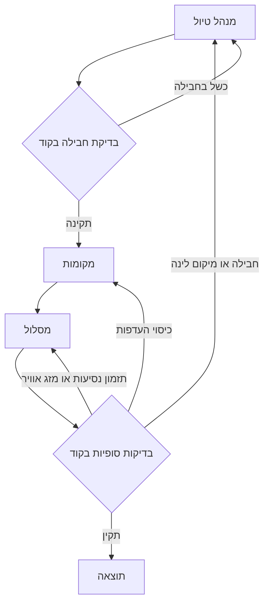

# ארכיטקטורת Travel Comparison Studio ותוכנית עבודה עד 30.10.2026

**עודכן:** 27.10.2026 — קיבוע שלושה סוכנים וחלוקת אחריות לפי [דף הצוות](../TEAM_SCOPE_HE.md)  
**בסיס הבדיקה המקורית מ־22.10:** קובצי הפרויקט שבדרייב: `AGENTS.md`, `README_HE.md`, `README_STREAMLIT_HE.md`, `src/travel_agent/*`, `scripts/*`, `tests/*`, `web/scenarios.json`, `web/recorded_baseline.json` והמחברות.  
**עדכון היקף 27.10:** ההיקף, הסכמות והזרימה נבדקו מול main בגרסה c7aa310. תיעוד נתונים והרצות קודם נשמר עם מגבלותיו. לא בוצעה כאן הרצת Gemini חיה או הרצה מחודשת של המחברת. פרטי מודל/מכסה ופריסת השירות דורשים אימות בסביבת ההרצה.

## 1. מטרת המערכת והיקף

Travel Comparison Studio משווה שלוש דרכים לתכנון אותה חופשה קבוצתית:

- **A — Code:** מנוע דטרמיניסטי של חיפוש, דירוג, בניית מועמדים ותיקון מוגבל.
- **B — Single Agent:** סוכן CrewAI יחיד (`TripPlanner`) שמקבל את כל כלי התכנון ומפיק תוכנית מלאה.
- **C — Three Agents:** מנהל טיול (`trip_manager`), מקומות (`places`) ומסלול (`itinerary`). זהו ההיקף המאושר לקראת 30.10; GM נוסף ומבקר איכותני אינם כלולים בו.

כל המערכות מקבלות את אותה בקשה, קוראות את אותו קטלוג וכללי בדיקה, ומחזירות אותו חוזה תוצאה. המוצר ממליץ בלבד: אין הזמנה, תשלום או נתוני זמינות חיים. זמינות לינה וקיבולת רכב מסומנות כנתונים סינתטיים/הערכה. אין להשתמש בדירוגים או ביקורות מומצאים.

## 2. רכיבי המוצר וההרצה

| רכיב | מיקום | אחריות |
|---:|---:|---:|
| ממשק React/TypeScript בעברית | `frontend/src/` | הזנת בקשה, בחירת תרחיש, הרצת השוואה, שלוש תוצאות, מסלול/פשרות/בדיקות/יומן, מדדים והורדת JSON |
| API | `src/travel_agent/api.py` | health, קטלוג ותרחישים, פתיחת והשגת השוואה, היסטוריה, יצוא JSON, תצורת מודל בזיכרון |
| מתזמר השוואה | `src/travel_agent/comparison.py` | מריץ A/B/C בתהליכים מבודדים, מצב מקביל להצגה או מבודד למדידה, deadline של 270 שניות, SQLite לאירועים ולתוצאות |
| pipeline משותף | `src/travel_agent/pipeline.py` | קבלה ואימות בקשה, שלב רכב, מזג אוויר, בניית מועמדים, שלבים משותפים ותשתית חישוב |
| מודלים וחוזים | `models.py`, `checks.py` | סכמות Pydantic לבקשה, חבילה, מקומות, מסלול, סטטוס ותוצאות בדיקה |
| נתונים וכלים דטרמיניסטיים | `data_access.py`, `tools.py` | קריאה מקומית לקטלוג/מקומות/מזג אוויר וחישובי מחיר, מרחק וזמן |
| מנוע A | `systems/rules_strong.py` (`rules`); `rules.py` (`rules_basic`) | בחירת חבילה ומקומות, תזמון חמדני, בדיקות ותיקון ללא LLM |
| מנוע B | `systems/single_agent.py` | Flow עם סוכן אחד, עד 3 סבבים, תכנון ובדיקה משותפת |
| מנוע C (כיום) | `systems/multi_agent.py` | Flow עם 3 סוכנים, ניתוב תיקון לפי סוג כשל ועד 3 סבבים |
| חיבור מודל | `systems/llm.py` | בחירת ספק/מודל מהסביבה, בדיקת זמינות ויצירת LLM משותף ל־B/C |
| יומנים ומדדים | `events.py`, `tool_log.py`, `monitoring.py`, `api.py` | אירועי שלבים/מודל/כלים, מדידת זמן ושימוש, תוצאות וצבירת מדדי benchmark |
| ממשק Streamlit/Colab | `streamlit_app.py`, `src/.../streamlit_view.py`, `streamlit_service.py`, `ui_worker.py`, `scripts/notebook_server.py` | נתיב הפעלה חלופי בפייתון וב־Colab. יש לוודא מהדורה פעילה מול סביבת הצוות לפני שמשווים ל־React/API. |
| הערכה | `eval/`, `scripts/` | מקרי בדיקה קפואים, ניקוד/איכות, הרצת הערכה, דוחות וסקריפט smoke ללא מודל |

### איך החלקים רצים יחד

1. המשתמש בוחר תרחיש או ממלא בקשה ומצב קלט.
2. React שולח `POST /api/comparisons` עם `ComparisonInput`: `request`, `request_text`, `title`, `mode`, `input_mode`, `pricing`.
3. ה־API מאמת שדות ומעביר למתזמר. בקלט טבעי נדרש גם `request_text`.
4. המתזמר יוצר ריצה לכל מערכת בתהליך נפרד. `demo_parallel` מיועד להצגה; `benchmark_isolated` מריץ למדידה מבוקרת. כל מערכת מקבלת אותם נתונים וכללי אימות.
5. כל מערכת מריצה intake → בדיקת/קבלת בחירת רכב → מזג אוויר → חיפוש מועמדי חבילה → החלטה ספציפית למערכת → בדיקות סופיות → בניית מסלול/רינדור; ב־C תתי־השלבים והניתוב מפורטים להלן.
6. אירועי התקדמות, שימוש במודל, קריאות כלים, סטטוס ותוצאה נרשמים. ה־UI מבצע polling, מציג השוואה, ומאפשר היסטוריה/יצוא.
7. timeout פנימי למערכת: 270 שניות; מדד ראשי משתמש בסף 300 שניות. אין להציג הצלחה על בסיס תוצאה שמורה או סינתטית כאילו הופקה מהרצה חיה.

## 3. קלט ופלט משותפים

### קלט מובנה (`TripRequest`)

בקשה כוללת: עיר יעד (`Chicago` או `New York`), שדה תעופה מוצא, תאריכי הלוך/חזור, מספר נוסעים, תקציב USD, האם נדרש רכב, קצב (`relaxed/normal/packed`), 1–4 תחומי עניין, תחומי הימנעות, העדפת לינה, תאריך `as_of`, גמישות תאריכים של עד יום, העדפות רכות ותקציב יעד, חלונות חסומים בכל יום, מגבלת הליכה, שעות התחלה/סיום, נגישות, איסור טיסות מוקדמות, משקלי עדיפות ודרישות לא ממופות.

הוולידציה מגבילה יעדים, שדות תעופה שמופיעים בקטלוג, תאריכים בטווח הקטלוג, נוסעים עד 6, חלון גמישות עד יום, אוצר מילים סגור ותחומי עניין/הימנעות לא חופפים. נגישות אינה נתמכת בדאטא: יש לסמן `NEEDS_DATA`, לא לטעון שנבדקה.

### קלט טבעי

`request_text` הוא טקסט חופשי. לפי חוזה ה־API, מצב `natural` חייב לכלול טקסט. המימוש והיקף הפענוח הטבעי המדויק צריכים להיבדק מול `systems/parsing/` ולסגור כתנאי שחרור; אין להניח שהטקסט מתורגם נכון לשדות בלי בדיקה.

### פלט

תוצאה לכל A/B/C כוללת סטטוס (`OK_PLAN`, `INVALID_REQUEST`, `NO_PACKAGE_IN_CATALOG`, `NEEDS_DATA`, `TECHNICAL_ERROR`, `CONFLICT_UNRESOLVED`, `TIMEOUT`), בקשה אפקטיבית, חבילה ומחיר שורות/סה״כ, פשרות/הסברים, מסלול יומי, מקורות וקריאות כלים, דוח בדיקות, זמן, סבבים, קריאות מודל/טוקנים כשדווחו, שגיאות ואירועי התקדמות. עלות מודל תחושב רק עם תעריפים שסופקו; אחרת תסומן כלא ידועה.

## 4. מערכות וסוכנים

### A — Code (ללא סוכן וללא קריאת מודל)

מנוע הכללים הראשי הוא `systems/rules_strong.py`, המופעל במזהה `rules`. `systems/rules.py` נשמר כגרסה בסיסית במזהה `rules_basic`. עושה חיפוש חלופות לפי אילוצים, ניקוד דטרמיניסטי, בחירת מקומות וכיסוי תחומי עניין, תזמון חמדני לפי מרחק/שעות פתיחה/מזג אוויר/עומס, והרצה של אותם validators. אין כאן קריאת מודל. הפלט הוא תוכנית ודוח בדיקות; אם אין בסיס נתונים מתאים מחזיר סטטוס חסר/אין חבילה.

### B — TripPlanner יחיד

- **תפקיד:** להחזיר חבילה אחת, פשרות ומסלול מלא שעוברים בדיקות, על סמך עובדות הכלים בלבד.
- **תהליך:** Flow משותף; שלב הסוכן מתכנן מתוך top-5 מועמדים (או מחפש ומתמחר שוב), בוחר מקומות ומתזמן; `final_checks` בודק ומנתב לתיקון. עד 3 סבבים; עד 12 איטרציות CrewAI בתוך משימה ועד 150 שניות לכל הפעלה, בכפוף לזמן שנותר.
- **כלים:** `search_flights`, `search_hotels`, `search_cars`, `calculate_price`, `search_places`, `get_place_details`, `get_travel_time`, `check_day_load`. כלים מוגבלים לנתונים המקומיים/חישובים; אין כתיבה למקורות הנתונים.
- **קלט סוכן:** בקשה מאומתת, מזג אוויר, מועמדי חבילות/תוצאות חיפוש, הקשר וכללי תכנון, משוב בדיקה מהסבב הקודם.
- **פלט:** `TripPlan` מובנה עם בחירת חבילה, מסלול יומי והפניות לכלי/מקורות; קוד מאמת אותו ומחשב סטטוס.
- **כשל נראה:** 503/429 של ספק עשוי לגרום לניסיון חוזר אחד אחרי 2 שניות; אם גם הוא נכשל, ההרצה נכשלת. retries אינם הבטחה לזמינות. יש למדוד קריאות בפועל.

### C — שלושה סוכנים

| מערכת ותפקיד | הצדקה | פלט קיים |
|---:|---:|---:|
| B TripPlanner | מרכז את כל החלטות התכנון כדי לבדוק אם סוכן אחד עם כל הכלים מספיק להפקת תוכנית תקינה. | TripPlan |
| C trip_manager מנהל טיול | בוחר טיסות, לינה ורכב ומנמק פשרות, משום שהחלטות החבילה מחייבות איזון משותף בין מחיר, תאריכים ומיקום. | PackageDecision |
| C places מקומות | בוחר אטרקציות ומסעדות לפי ההעדפות ומיקום הלינה כדי לרכז את התאמת התוכן ואת מקורות המידע. | PlaceShortlist |
| C itinerary מסלול | משבץ מקומות לימים ולשעות לפי נסיעות, קצב ומזג אוויר כדי לרכז את בדיקת האפשרות לבצע את התוכנית. | ItineraryPlan |

אותה מטרה נבחנת מול B באמצעות חלוקת החלטות לחבילה, מקומות ותזמון. לא הוכח עדיין שהחלוקה משפרת תוצאות. ה־Flow רץ בסדר תלוי־תוצר: מנהל טיול בוחר לינה, places מתאים מקומות סביב הלינה, ו־itinerary מתזמן אותם.

בדיקות החבילה והבדיקות הסופיות הן קוד. מנהל הטיול אינו GM נוסף ואינו מנתב בעצמו את יתר הסוכנים. קוד מחזיר כשל חבילה או HOTEL_TOO_FAR למנהל הטיול, כשל כיסוי למקומות לכל היותר פעם אחת, וכשל תזמון למסלול. החלפת חבילה מחייבת חידוש מקומות ומסלול. guardrail מאפשר ניסיון חוזר של אותו סוכן על כשל מקור או סכמה. מגבלת שלושת הסבבים היא כוללת; ניסיונות ספק ו־guardrail נמדדים בתוך תקציב 270 השניות.

הכלים המורשים והסכמות המדויקות מפורטים ב[מפרטי שלושת הסוכנים](../agent_specs/README.md). [התרשים התפעולי](Travel_Architecture_Visual_HE.svg) מציג את המבנה המאושר.

## 4A. חוזי קלט/פלט ברמת שדות

**מקור הסכמה:** חוזי TripRequest, PackageDecision, PlaceShortlist, ItineraryPlan, DayPlan, Item, Dropped, CheckReport ו־RunResult נבדקו מול models.py שבפרויקט. להלן השדות כפי שמוגדרים בקוד הנוכחי. לא מוסיפים חוזי GM או Reviewer בהיקף הנוכחי. סימון `?` משמעו רשות/nullable; שדות עם ברירת מחדל אינם חייבים להישלח.

### א. בקשה משותפת — TripRequest

| שדה | טיפוס | חובה/ברירת מחדל | משמעות/מקור |
|---:|---:|---:|---:|
| request_id | string | ברירת מחדל ADHOC | מזהה הבקשה/תרחיש |
| city | enum: Chicago, New York | חובה | עיר היעד |
| origin | string, 3 תווים | חובה; נשמר uppercase | קוד שדה תעופה מוצא |
| start_date, end_date | date | חובה | תאריכי הנסיעה; end_date אחרי start_date ובטווח הקטלוג |
| travelers | integer 1–MAX_TRAVELERS (עד 6 לפי האפיון) | חובה | מספר נוסעים |
| budget_usd | integer > 0 | חובה | תקרת תקציב קשיחה |
| wants_car | boolean | חובה | האם נדרש רכב |
| pace | relaxed / normal / packed | default normal | קצב הטיול |
| interests | list[Interest], 1–4 | חובה | food, culture, attractions, nightlife, family, nature, shows, shopping, extreme/adventure |
| avoid | list[Interest] | [] | תחומים להימנע מהם; לא חופפים ל־interests |
| hotel_preference | any / central | default any | העדפת לינה |
| as_of | date | חובה | תאריך ייחוס לתחזית/נתונים |
| free_text, request_text | string? | null | טקסט עזר והטקסט המקורי; שומרים request_text ללא שינוי |
| depart_flex_days, return_flex_days | integer 0–1 | 0 | גמישות תאריך לכל כיוון |
| soft_prefs | list[SoftPref] | [] | central, nonstop, exact_dates, dry_days, long_days, under_preferred_budget |
| preferred_budget_usd | integer? >0 | null | יעד רך, חייב להיות עד budget_usd |
| daily_blocked_windows | list[BlockedWindow] | [] | חלונות אסורים בכל יום; כל פריט: start, end (HH:MM), label |
| max_walk_minutes | integer? 1–120 | null | מגבלת רגל יחידה |
| day_start, day_end | HH:MM? | null | שעות יום; ברירות מחדל בקונפיגורציה אם לא נמסרו |
| accessibility | boolean | false | צורך בנגישות; אין נתוני נגישות ולכן מחייב NEEDS_DATA |
| no_early_flight_before | HH:MM? | null | שעת המראה מוקדמת ביותר |
| priority_weights | map[string,float] | {} | משקלים רק למפתחות המותרים: central, nonstop, exact_dates, dry_days, long_days, under_preferred_budget, price |
| unparsed_requirements | list[string] | [] | דרישות שהובנו אך לא ניתן למפות; יש לשמר ולסמן |

### ב. ארטיפקטים קיימים לסוכנים

| חוזה | שדות מדויקים | שימוש |
|---:|---:|---:|
| PackageDecision | flight_out_ref:string; flight_back_ref:string; hotel_ref:string; car_ref:string?; price_call_id:string; total_price:float; tradeoffs:list[string]=[]; relaxed_constraint:string?; rationale:string (עד 600 תווים) | פלט מומחה חבילות קיים. refs מצביעים לאפשרויות כלי, והמחיר חייב להגיע מ־calculate_price |
| PlaceChoice | place_id:string; category:string=""; indoor:string="unknown"; est_duration_min:int=60; matched_prefs:list[string]=[]; reason:string=""; source_call_id:string="" | פריט ברשימה נבחרת |
| PlaceShortlist | places:list[PlaceChoice]; uncovered_prefs:list[string]=[] | פלט מומחה מקומות קיים |
| Item | place_id:string; name:string=""; kind:activity/meal="activity"; start,end:HH:MM; mode:walk/transit/drive; travel_min:int; travel_call_id:string; from_id:string=""; weather_note:string? | פעילות/ארוחה במסלול; from_id הוא stay ref או place_id |
| DayPlan | date:string; items:list[Item]=[]; flags:list[string]=[]; window:tuple[HH:MM,HH:MM]? | יום במסלול |
| Dropped | place_id:string; reason:string | מקום שלא שובץ; סיבות לדוגמה WEATHER/NO_SLOT/DAY_LOAD/CLOSED |
| ItineraryPlan | status:OK/CANNOT_SCHEDULE="OK"; days:list[DayPlan]=[]; dropped:list[Dropped]=[]; cannot_reason:DAY_LOAD/TRAVEL_TIME/WEATHER/HOTEL_TOO_FAR?; explanation:string="" | פלט מומחה מסלול קיים |
| CheckReport | checks:list[{name:string, passed:boolean, details:list[string]=[]}]; coverage:float?; rain_days:list[string]=[] | דוח בדיקות קוד |

### ג. קלט ופלט לכל תפקיד ב־C

| סוכן | ההקשר המועבר כיום למשימה | פלט |
|---:|---:|---:|
| trip_manager | request, nights, top5_candidates, city_airports, כללים ומשוב מתיקון קודם אם קיים | PackageDecision |
| places | city, interests, avoid, free_text, pace, days, rain_days, lodging עם ref ו־lat/lon, כללים ומשוב אם קיים | PlaceShortlist |
| itinerary | pace, travel_mode, lodging_ref, day_windows, weather, places, interests, כללים ומשוב אם קיים | ItineraryPlan |

הטבלה מתארת את תוכן ה־prompt הנבנה ב־multi_agent.py. אין PlanningBrief ואין דוח מבקר כתלות קלט. אין להסיק שכל שדה ב־TripRequest מועבר במפורש לכל סוכן או שכל אילוץ נאכף רק מעצם קיומו בסכמה.

### ד. טיפוסי אפשרויות ו־metadata של כלים

| טיפוס | שדות |
|---:|---:|
| FlightOption | ref, origin, destination, date, arrival_date, dep, arr, fare, stops, duration, seats, airline? |
| StayOption | ref, title, market, price_per_night, km_to_center, lat, lon, capacity, min_nights, max_nights, central |
| CarOption | ref, airport, make, model, vehicle_type, daily_rate, rental_days, estimated_capacity, capacity_basis="estimate" |
| PlaceSummary | place_id, name, category, tags, indoor=true/false/unknown, lat, lon, neighborhood, in_wikivoyage, has_wikidata, typical_visit_minutes, typical_visit_minutes_basis="estimate", source, license |
| DayCondition | date, lead_days, precip_mm?, precip_h?, apparent_max?, gust_max?, flags, source, fetched_at |
| ToolMeta | call_id, source, license, data_date |

כל תשובת כלי נרשמת ביומן עם `call_id`, שם כלי, args ו־output; כלי הנתונים הם לקריאה בלבד. לא להעביר לסוכנים או להציג שדות סינתטיים אסורים כגון rating/review_count/price_level.

### ה. תוצאה משותפת — RunResult

פלט הריצה השמור כולל: run_id, system (A/H/B/C), variant?, parser?, parse_notes, parse_llm_calls, request_id, status, message, request?, parsed_request?, package?, candidates[], days[], dropped[], tradeoffs[], weather_status, day_conditions[], check_report?, all_checks_passed, rounds_used, llm_calls, tokens_in, tokens_out, wall_time_s, tool_log_path?, tool_log[], notes[]. זהו חוזה הריצה הקיים; משימה 1 אינה משנה אותו.

**הערה חשובה למימוש:** models.py הוא מקור האמת לשמות שדות וטיפוסים, ו־crew_tools.py לממשק הכלים שנחשף לסוכנים. מפרטי Markdown ו־Word מתארים את אותם חוזים; אין קדימות אוטומטית ל־Word.

## 4B. בדיקת מבנה הנתונים המקורית מ־22.10

**הערת עדכון 27.10:** קובצי data קיימים במאגר. מגבלת הגישה בדרייב המתוארת להלן היא תיעוד הבדיקה המקורית, ואינה טענה שהנתונים חסרים כיום בגיט. בדיקת כל שורות הנתונים אינה חלק ממשימה 1.

בדקתי את `models.py`, `data_access.py`, `config.py` ו־`tools.py` שב־`src/travel_agent/`. זה מאמת את הסכמה שהקוד **מצפה** לה ואת המיפויים של הכלים. קובצי המקור עצמם (`data/inventory.json`, `data/places/*.csv`, `data/weather/*`) אינם מופיעים ברשימת הקבצים והתיקיות הזמינים בדרייב, לכן אי אפשר לאמת את הדוגמאות/כל השורות בפועל, לבדוק חסרים או לאשר שכל שדה קיים בכל רשומה. בהתאם, להלן אימות מבני של הקוד, לא בדיקת איכות של תוכן הקטלוג.

### inventory.json — מבנה נדרש לפי Catalog

| נתיב/רשומה | מפתחות שהקוד קורא | הערות אימות |
|---:|---:|---:|
| root | dates[], flights[], stays[], staysByAirport{}, cars[], carsByAirport{}, originAirports[], dataNotes? | dates הוא ציר הזמן לפענוח זמינות; dataNotes אופציונלי |
| flights[] | origin, destination, date, arrivalDate, departure, arrival, fare, seats; nonstop?, duration?, airline? | הקוד מוסיף ref מסוג F{index}; seats<=0 מסונן. FlightOption מחזיר ref/origin/destination/date/arrival_date/dep/arr/fare/stops/duration/seats/airline |
| stays[] | key, market, title?, price, lat, lon, capacity, availabilityPacked, minNightsPacked, maxNightsPacked | packed arrays מקודדים ביחס ל־dates; title עובר ניקוי/קיטוע. stay ref הוא key |
| cars[] | id, make?, model?, type?, dailyRate, capacityEstimate, blackouts[]? | blackouts משמשים לסינון חפיפת תאריכים; capacityEstimate הוא אומדן בלבד; car ref מקבל C לפני id |
| originAirports[] | code | נבנית רשימת שדות מוצא |
| staysByAirport / carsByAirport | מפתח airport וקבוצת stay keys / car ids | חייבים להפנות לרשומות הקיימות במערכים |

### places CSV — כותרות שהקוד קורא

נדרשים לפחות: `place_id`, `name`, `category`, `tags`, `indoor`, `lat`, `lon`, `typical_visit_minutes`, `source`, `license`. `tags` הוא מחרוזת עם מפריד `;`. שדות נוספים שהקוד יכול לקרוא: `subcategory`, `neighborhood`, `in_wikivoyage`, `wikidata`, `opening_hours`, `website`, `address`, `description_short`, `source_url`, `retrieved_at`. תוצאת כלי המקום מנרמלת indoor לערכי true/false/unknown, מתייחסת למשך הביקור כאומדן, ומחזירה מקור/רישיון. שדות `rating`, `review_count`, `price_level` נאסרו במפורש ואינם נחשפים לסוכנים.

### weather JSON — מבנה שהקוד מצפה לו

Fixture יומי נקודתי: `daily` עם `precipitation_sum`, `precipitation_hours`, `apparent_temperature_max`, `wind_gusts_10m_max`, `temperature_2m_max`, וכן `source`, `license`, `retrieved_at`. Fixture עונתי: `api_response.daily` עם `time[]` וערכי סדרות יומיות לאותם מדדים, בנוסף metadata של מקור/רישיון/שליפה. `data/weather` לא נמצא ברשימת התיקיות הזמינות, לכן זהו חוזה קריאה מהקוד, לא אימות של fixtures.

### מיפויי הכלים שאומתו

- טיסות: `search_flights(origin, airports, date, min_seats, direction)`; direction הוא out/back. המחיר הוא fare לאדם; תמחור כולל מתבצע בכלי נפרד.
- לינה: `search_hotels(city, check_in, check_out, guests, central)`; מסנן קיבולת, זמינות packed, מינימום/מקסימום לילות ומרחק עד 12 ק״מ (או רדיוס central).
- רכב: `search_cars(airport, start, end, travelers)`; זמינות לפי blackouts וקיבולת מוערכת. מעל 4 נוסעים מוחזר NEEDS_DATA.
- מחיר: `calculate_price(refs, travelers, nights)` מחזיר `refs`, `travelers`, `nights`, `lines{flights,lodging,car}`, `total`, `rental_days?`, `fees_complete=false`, `currency=USD`. זה המקור היחיד לסך חבילה מאומת; אינו כולל עמלות מלאות.
- מקומות: `search_places(city,tags,indoor_only,near,limit,exclude_tags)` מחזיר `places[]`, `n`, ו־metadata; `get_place_details(place_id,city?)` מוסיף opening_hours, website, address, description_short ו־source_url או status/error.
- נסיעות: `get_travel_time(pairs,mode)` מחזיר אומדן לכל זוג ומזהי call; זמן הנסיעה הוא חישוב גיאוגרפי בקוד ולא זמן ניווט חי.
- מזג אוויר: `get_forecast` הוא שלב Flow ולא כלי לסוכן; מחזיר days[] ו־weather_status עם flags/מקור/זמן שליפה/ספי סיווג.

### פערים שיש לסגור לפני חלוקת משימות פיתוח

1. קובצי `data/` קיימים במאגר. בבדיקת נתונים נפרדת יש לבדוק JSON/CSV בפועל: שדות חסרים, טיפוסים, מזהים לא ייחודיים, הפניות שבורות, תאריכים ו־packed lengths.
2. להגדיר האם מכניסים שדות מקומות/מזג אוויר אופציונליים לכל הרשומות או שהיעדרם נשאר unknown; הקוד ממילא מנרמל חלק מהערכים החסרים.
3. בחוזה PlaceSummary שהוגדר קודם חסר שדה `subcategory` שקיים ב־PLACE_FIELDS_PUBLIC, אך כרגע אינו מוחזר על ידי `place_summary`; אין להניח שסוכן יקבל אותו עד שינוי הכלי/מודל.
4. `PackageDecision` הוא ההחלטה הפנימית; תוצאת ה־API העשירה היא `Package` עם refs, price_lines, total, price_call_id, פרטי flight_out/flight_back/stay/car אופציונליים ו־fees_complete. יש למפות ביניהם במפורש ולא לערבב את שני החוזים.
5. בפרויקט הנוכחי מיפוי קלט טבעי הוא מערכת־ספציפי (keyword ל־A, hybrid LLM ל־B/C לפי המודלים/RunResult); יש להשוות B ו־C עם אותו TripRequest מנורמל ועם אותו request_text מקורי, ולמדוד parse_llm_calls בנפרד כחלק מ־llm_calls.
## 5. כלים וחוזה הנתונים

כל כלי מחזיר JSON-serializable עם `call_id`, `source`, `license`, `data_date` ומתעד `args` ו־`output` ביומן הכלים. ה־LLM אינו מקבל שדות סינתטיים `rating`, `review_count`, `price_level`.

| כלי | מה הוא קורא/מקבל | מה הוא מחזיר |
|---:|---:|---:|
| `search_flights` | origin, airports, date, min_seats, direction; `inventory.json` | טיסות חד-כיווניות, fare לנוסע, עצירות, זמנים, מושבים ומקור |
| `search_hotels` | city, check-in/out, guests, central; מלאי, זמינות/מינימום לילות מקודדים | אפשרויות העומדות בקיבולת/תאריכים/מרחק ומחיר ללילה |
| `search_cars` | airport, start/end, travelers; מלאי רכב | רכב/מחיר ליום/ימי השכרה; קיבולת מוערכת, מעל 4 נוסעים חסר מידע |
| `calculate_price` | הפניות טיסות/לינה/רכב, נוסעים ולילות | שורות מחיר וסה״כ; המקור היחיד למחיר חבילה תקף |
| `get_forecast` / `get_weather` | city + תאריכים + `as_of`; קובצי מזג אוויר במטמון | תנאי יום/דגלים/סטטוס תחזית ומקור |
| `search_places` | city, tags, indoor, near, limit, exclude_tags; CSV מקומות | מזהה/שם/קטגוריה/תגיות/ indoor/מיקום/משך ביקור משוער/מקור |
| `get_place_details` | place_id | שעות פתיחה (או unknown), אתר ותיאור קצר לפי נתוני המקור |
| `get_travel_time` | זוגות נקודות ומצב הליכה/תחבורה/רכב | דקות, mode, מזהה קריאה; הערכה גיאוגרפית לפי נוסחה |
| `check_day_load` | מסלול/פריטים/חלונות יום | האם היום עומד במגבלות פעילות/שעות/נסיעה |

## 6. נתונים שנקראים ונכתבים

### קריאה

- `data/inventory.json`: טיסות היסטוריות, מקומות לינה ומכוניות. טווח תאריכים מתועד 17.04.2022–19.11.2022.
- `data/places/chicago_places.csv`, `nyc_places.csv`: נתוני OpenStreetMap/Wikivoyage; כוללים מקור/רישיון ותאריך שליפה. אם קובץ עיר חסר, מקומות עשויים להיות unavailable.
- `data/weather/*.json`: מטמון מזג אוויר, תחזית עד 7 ימים; מעבר לאופק או קובץ חסר מסומן בהתאם.
- `web/scenarios.json`: ארבעה תרחישי הדגמה, ארבע נוסעות בכל תרחיש לפי המסמכים. תוצאות baseline שמורות ב־`web/recorded_baseline.json` הן לעיון בלבד, לא הרצה חיה.
- `eval/cases/*`: מקרי הערכה קפואים לגרסאות v1/v2/v3; `eval/results/` לדוחות.
- הגדרות: משתני סביבה/`.env` ומפתח ספק; המפתח לא נשמר בקוד, בתוצאות או ב־DB. ממשק ה־API מחזיק מפתח בזיכרון בלבד.

### כתיבה/תוצרים

- SQLite דרך `comparison.py`: השוואות, סטטוסי ריצה, תוצאות ואירועי מדידה. ה־DB הוא תוצר תפעולי ואינו מקור קטלוג; יש לאשר מיקום, גיבוי ומדיניות שמירה מול גרסת הקוד העדכנית.
- `ToolLog`/events: קריאות כלי, ארגומנטים/תשובות, מזהים, שלבי ריצה, מודל, זמן ושימוש. monitoring מצהיר שאינו מייצא prompt או reasoning. יש לבדוק בפועל ש־redaction מכסה את כל שמות משתני המפתח והודעות השגיאה.
- `eval/results/`: קובצי תוצאות הערכה ודוחות שנוצרו בסקריפטים.
- ייצוא JSON מ־`GET /api/comparisons/{id}/export`; היסטוריה דרך API. לפי README, הורדות מהממשק זמניות/מקומיות עד שמירה יזומה.
- מקורות `inventory.json`, CSV ו־weather נחשבים לקריאה בלבד על ידי מנוע התכנון. אין כתיבה בחזרה לקטלוג או לספקי נסיעות.

## 7. מדדים והערכת איכות

### מדד ראשי

`feasible success`: תוכנית שעוברת את כל בדיקות הקוד בתוך 300 שניות ולכל היותר 3 סבבים. תהליך נקטע אחרי 270 שניות כדי להשאיר מרווח. timeout וכשל טכני נספרים ככשל בהרצות benchmark; היעדר מודל צריך להישמר כקטגוריית setup נפרדת, לא לערבב עם ביצועי סוכן.

### מדדי השוואה

- סטטוס ותוצאה תקינה מול validators.
- זמן מנוע, זמן כולל תהליך, deadline/timeout וסבבי תיקון.
- קריאות מודל וטוקנים, אם הספק מדווח אותם; retries ושגיאות ספק.
- מספר קריאות כלים וזמני כלים לפי `call_id`.
- כיסוי תחומי עניין; התאמה להעדפות הרכות שניתן לבדוק.
- מחיר חבילה ושורות מחיר; עלות מודל רק אם הוגדרו תעריפים מאומתים.
- סוג פשרה/דרישות שלא כוסו והאם התוצאה נשארה grounded במקורות.
- מצב `demo_parallel` לדמו ומצב `benchmark_isolated` למדידות. לצורך טענה השוואתית יש להשתמש בהרצות מבודדות, אותם inputs/model/settings, ולשמור לכל ריצה נתוני תצורה ומזהה תרחיש.

אין להסיק אחוזי הצלחה ממדגם קטן או מהרצה יחידה. בדיקות API עם fake LLM מאמתות חיווט/חוזים בלבד, ואינן ראיה לאיכות מודל אמיתי.

## 8. מצב הרצות מתועד מ־22.10 ללא הרצה מחודשת

1. התקבלה שגיאת `503 UNAVAILABLE` ב־B עם 0/0 בדיקות ו־0 קריאות מודל בתצוגה שצורפה. זו שגיאת זמינות/עומס מספק, אך מוני 0 מצביעים גם על חשד שהאירועים לא נאספו/נטענו באותה ריצה. יש לאמת את המודל שנבחר, גרסת הקוד, log events והאם retry אחד התרחש.
2. C הסתיים בעבר ב־timeout ב־270.29 שניות; ללא טלמטריה פעילה אין לדעת איזה agent/קריאה חסמו. אחרי התיקון יש לבדוק אירועים לפי agent, משך כל קריאה, סבבים, retries ו־pending tools.
3. הבחירה האחרונה שנדונה למודל הייתה Gemini Flash-Lite, אך הקוד שנקרא בתיקיית הפרויקט מגדיר ברירת מחדל מקומית `ollama/qwen2.5:7b-instruct`, ומאפשר `gemini/*` דרך משתני סביבה. לא נמצאה הוכחה שהבחירה החדשה נשמרה/פעילה במהדורת הפרויקט העדכנית. צריך להכריע מודל וספק בפועל ולוודא מזהה נתמך, API key, מכסה ותאימות CrewAI.
4. מחברת Colab הפעילה, מחברת 2, אפליקציית Streamlit ותיקיית `project` אינם אותו נתיב. יש לבחור מקור אמת אחד, לוודא איזו גרסה הצוות מפעיל, ואז לעדכן manifest/README/מחברת בהתאם. לא לערוך עותק שגוי.
5. `README_STREAMLIT_HE.md` מתעד ש־Colab/Gemini אמיתי דורשים בדיקה בחשבון. `RELEASE_MANIFEST.json` של הפרויקט החדש (כיום ב־`archive/release/`) מתעד `real_model_tested: false`.
6. הנתונים היסטוריים/חלקם סינתטיים. אין להציג אותם כמחירים/זמינות נוכחיים.

## 9. אחריות ותוכנית עבודה עד 30.10.2026

ההיקף והשיבוץ נקבעים ב[דף הצוות](../TEAM_SCOPE_HE.md). חלוקת האחריות נעשתה שרירותית לבקשת רן; ניתן להעביר משימה בתיאום.

| תחום | אחראי/ת | אחריות |
|---:|---:|---:|
| מוצר ותיעוד | רן | היקף, תיעוד, תוצרים למרצה וריכוז המשימות |
| סוכנים ואינטגרציה | גלית | B, זרימת C, ממשקים, סבבים ותקציב זמן |
| נתונים וכלים | שמואל | קטלוג, כלי חיפוש וחישוב, מקורות ואומדנים |
| מודלים והערכה | דניאל | A, הגדרות ההשוואה, בדיקות ודוחות |
| C מנהל טיול | גלית | חבילת טיסות ולינה ורכב לפי צורך, תמחור ופשרות |
| C מקומות | שמואל | אטרקציות ומסעדות, התאמה להעדפות ומקורות |
| C מסלול | דניאל | ימים ושעות, נסיעות, עומס ומזג אוויר |

ב־27.10 מקבעים תיעוד והיקף. משימות ההמשך הן ייצוב הרצה קיימת, הוכחת טיפול בהתנגשות והשוואת A/B/C. אין משימת מימוש GM או מבקר איכותני. פירוט הממשקים של שלושת הסוכנים הקיימים נמצא ב[מפרטי הסוכנים](../agent_specs/README.md).

## 10. הגדרת Done לשחרור

- קובץ/commit אחד הוא מקור האמת והצוות יודע לפתוח אותו.
- מודל B/C נבדק באותו ספק ובאותה הגדרה, תוצאות setup נפרדות מתוצאות איכות.
- לכל agent יש input/output schema, כלים מורשים, קריטריון הצלחה ומסלול כשל.
- קטלוגים לקריאה בלבד ומקורות/רישיונות/תאריך נראים בתוצאות; אין שדות סינתטיים אסורים.
- pipeline וכתיבות DB/ייצוא מוסברים, secrets עוברים redaction, ו־SQLite לא מכיל מפתחות או prompts פרטיים.
- בדיקות אוטומטיות + smoke בלי מודל + לפחות ריצת מודל אמיתי מתועדת (אם מפתח/מכסה זמינים).
- מדדים מוצגים עם הגדרות, מצב ריצה, גרסת קוד, מודל/תצורה וגודל מדגם; אין טענות סטטיסטיות מהרצה יחידה.

## מקורות קוד שיש לשמור מסונכרנים עם המסמך

`AGENTS.md`; `README_HE.md`; `README_STREAMLIT_HE.md`; `src/travel_agent/api.py`; `comparison.py`; `pipeline.py`; `models.py`; `data_access.py`; `tools.py`; `checks.py`; `events.py`; `tool_log.py`; `monitoring.py`; `systems/rules.py`; `systems/single_agent.py`; `systems/multi_agent.py`; `systems/crew_tools.py`; `systems/llm.py`; `web/scenarios.json`; `web/recorded_baseline.json`; `eval/`; `tests/`; `scripts/`.

## 11. מפרטים פעילים ומפרטים שנשמרו כרעיון

שלושת המפרטים הפעילים הם 02 מנהל טיול, 03 מקומות ו־04 מסלול. לכל אחד גרסת Markdown ו־Word התואמות למימוש הקיים. 01 GM ו־05 Reviewer נשמרים כרעיונות מחוץ להיקף המאושר; הם אינם מטלות פיתוח לקראת 30.10.

אין ליצור PlanningBrief, DecisionRecord, QualitativeReview, GMBrief או GMDecision כחלק ממשימה 1. בדיקות קשיחות וניתוב תיקונים נשארים בקוד. יש לבדוק סוגי שדות ישירות ב־models.py והרשאות כלי ב־crew_tools.py; אין לשנות קוד כדי להתאימו לטבלת שדות ישנה.

שינוי התיעוד אינו הוכחת הרצה חיה. B/C עדיין דורשות הוכחת קצה לקצה מול מודל אמיתי במסגרת המשימות הבאות.

## 12. טכנולוגיות הפיתוח וההרצה

הטבלה מפרידה בין טכנולוגיות שזוהו במסמכי הפרויקט לבין פרטי סביבה שעדיין צריך לאמת בקובצי התלויות ובמהדורה הפעילה. שמות קבצים ומודולים אינם מספיקים כדי לקבוע גרסה או פקודת הפעלה, ולכן אין להשלים אותם בהשערה.

| שכבה | טכנולוגיה/רכיב שזוהו | שימוש | מה עדיין צריך לקבע ולאמת |
|---:|---:|---:|---:|
| ממשק משתמש | React ו־TypeScript | ממשק השוואת A/B/C בעברית, תוצאות, מדדים והיסטוריה | גרסאות Node ו־React, מנהל חבילות, פקודת build/dev, מקור האמת מול Streamlit |
| API ושרת | Python; API בפרויקט תחת `src/travel_agent/api.py` | קבלת בקשות, הרצות, תוצאות והיסטוריה | מסגרת ה־API המדויקת, גרסת Python, שרת ASGI/WSGI ופקודת הפעלה |
| תזמור סוכנים | CrewAI ו־Flow | סוכן יחיד ב־B וזרימת סוכנים ב־C | גרסת CrewAI, תלותי agent/tool, מבנה ההפעלה והגדרות timeout בפועל |
| סכמות נתונים | Pydantic | חוזים לבקשה, חבילה, מקומות, מסלול ותוצאות בדיקה | גרסה מדויקת ומקור סכמות יחיד בין UI/API/סוכנים |
| שמירה תפעולית | SQLite | תוצאות השוואה, סטטוסים ואירועי מדידה | מיקום DB, מיגרציות, גיבוי, retention והאם כל ממשקי ההרצה כותבים לאותו DB |
| נתוני דומיין | קובצי קטלוג מקומיים וכלי קריאה/חישוב | טיסות, לינה, רכב, מקומות, מזג אוויר וחישובי מחיר/מרחק/זמן | רשימת קבצים וגרסאות data snapshot, schema, provenance, רישוי ותאריך עדכון |
| מודל שפה | ממשק בחירת מודל דרך `systems/llm.py`; תועדו `ollama/qwen2.5:7b-instruct` כברירת מחדל מקומית ו־`gemini/*` דרך משתני סביבה | הפעלת B/C | ספק ומזהה מודל מאושרים למהדורה, גרסת SDK, API key/secret configuration, מכסה ותעריפים; הבחירה אינה מאומתת כחיה |
| UI חלופי | Streamlit ו־Colab | מסלול הפעלה חלופי בפייתון/מחברת | האם נתמך או הוחלף ב־React/API, ומחברת/גרסה מדויקת להפעלה |
| בדיקות והערכה | `tests/`, `eval/`, `scripts/` | בדיקות חיווט, בדיקות כלים, smoke, תרחישי benchmark ודוחות | פקודות הרצה, סביבת CI, תרחישים מחייבים, והפרדה בין fake LLM להרצת מודל אמיתי |
| תצורה וסודות | משתני סביבה ו־`.env` לפי התיעוד | הגדרת מודל/ספק; מפתח נשמר מחוץ לקוד וב־API בזיכרון בלבד | שמות משתנים מדויקים, מקור secrets בצוות, מדיניות redaction, וידוא שאין מפתח ב־SQLite או logs |
| פריסה ותפעול | תהליכים מבודדים ב־comparison.py; deadline שתועד כ־270 שניות | הרצת A/B/C, שמירת אירועים ותוצאות | פלטפורמת deployment, פקודת start, health checks, מגבלות משאבים, logging ו־shutdown |

### פרטי סביבה שחובה להוסיף לפני handoff למפתחים

1. קובצי תלות נעולים: `pyproject.toml` או `requirements*.txt` עבור Python ו־`package.json` יחד עם lockfile עבור frontend.
2. גרסאות Python, Node, React, CrewAI, Pydantic וספריות ספק ה־LLM, כפי שנקראות בפועל מהקבצים הנעולים.
3. פקודות מדויקות ליצירת סביבה, התקנה, הפעלת backend, הפעלת frontend, בדיקות ו־smoke.
4. מפתחות ותצורה: שמות משתני הסביבה, איפה כל מפתח מוגדר לצוות, ואילו ערכים לעולם לא נכתבים ל־DB או ליומן.
5. מודל וספק מאושרים ל־B/C, כולל מזהה מדויק, fallback, timeout/retry ותעריף מתוארך לצורך חישוב עלות.
6. סביבת פריסה פעילה ומקור האמת בין React/API לבין Streamlit/Colab; לציין כתובות/שירותים רק לאחר אימות, וכן תהליך עדכון ו־rollback.

עד שהפרטים האלה יאומתו מול קובצי התלויות והפריסה הפעילה, הטבלה היא מפת טכנולוגיות חלקית ולא מדריך התקנה שניתן להריץ לפי העתקה בלבד.

## 15. סנכרון התרחישים עם המחברת וקובץ ההרצה — 22.10.2026

### החלטת ועדת התרחישים

- S01 נשאר קו בסיס ישים.
- S02 עודכן בקובץ `project/web/scenarios.json`: התקציב הועלה מ־$950 ל־$1,275. על בסיס סריקת הקטלוג המתועדת לאותה בקשה, המחיר הזול ביותר הוא $1,294.80, ולכן הפער הוא $19.80 והציפייה נשארת `no_package`. הקובץ שומר את catalog SHA ואת `reverify_before_benchmark=true`; לפני benchmark חדש יש לבצע סריקה דטרמיניסטית חוזרת.
- S03 נשאר פשרה בין לינה מרכזית לטיסה ללא עצירות. לפני שימוש בתוצאת האיכות יש לוודא שהחלופות יוצרות trade-off בפועל.
- S04 נשאר פשרה בין גמישות תאריכים לימים יבשים. מדובר בנתוני מזג אוויר היסטוריים/סינתטיים ולא בתחזית חיה.
- S05 הוגדר כמועמד בלבד: התחלה ב־10:00, חלון מנוחה 13:00–15:00 ומגבלת הליכה של 25 דקות. הוא אינו מופעל למשתמשים עד אימות שמערכות A/B/C וה־validators אוכפים את השדות ושיש נתוני שעות פתיחה/מעברים מספקים.

### ממצאי התאמה מול המחברת הפעילה

המחברת הפעילה במאגר היא `notebooks/travel_streamlit_colab.ipynb`. תא הטעינה הראשוני מעתיק את `project/web` מ־Drive לעותק העבודה. תא ההפעלה האחרון מעתיק את קובצי המעקב, אך בגרסה שנבדקה לא העתיק מחדש את `project/web/scenarios.json`. לכן הפעלה מחדש של תא ההפעלה בלבד עלולה להשאיר את עותק התרחישים הישן בעותק העבודה.

תיקון שבוצע במחברת: תא ההפעלה האחרון מעתיק כעת את `SOURCE/project/web/scenarios.json` אל `PROJECT/web/scenarios.json` לפני אתחול Streamlit. כך טעינת התרחישים בהרצה חדשה תשתמש בקובץ המעודכן גם ללא התקנה חוזרת. המחברת נבדקה כמבנה JSON תקין, נשארה עם 8 תאים, וקוד תא ההפעלה עבר בדיקת תחביר Python. לא בוצעה כאן הרצה חיה של Colab או של Gemini.

### השוואה למבנה המערכות

עדכון S02 הוא שינוי נתונים/קלט בלבד; הוא אינו משנה את חלוקת A/B/C. S05 בוחן אילוצים שכבר מופיעים בחוזה `TripRequest`, אך קיום שדה בסכמה אינו מבטיח שכל מערכת אוכפת אותו. לכן הוא נשאר מחוץ לסט הפעיל עד בדיקה בקוד ובוולידטורים.

עדכון היקף 27.10: C המאושר כולל שלושה סוכנים בלבד: trip_manager, places, itinerary. GM נוסף ומבקר איכותני אינם נכללים בהיקף לקראת 30.10. המחברת מפעילה את המימוש הקיים; עדכון התיעוד אינו משנה את קוד הסוכנים ואינו הוכחה להרצה חיה.

